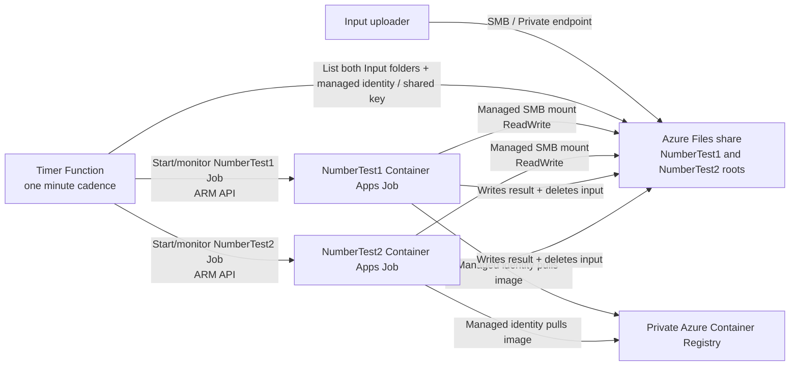

# Private Burst Processing with Azure Container Apps

This solution processes numeric files on an Azure SMB file share with an on-demand Container Apps Job. A timer-triggered .NET Function checks the share every minute, starts one job execution when a new input file is present, and observes completion. The job runs an .NET container image and then exits; no worker replica remains running when there is no work.

## Solution Layout

| Folder | Responsibility |
|---|---|
| `number-worker/` | .NET worker executable, Dockerfile, and deployment notes. |
| `number-worker.tests/` | MSTest coverage for number processing. |
| `timer-function/` | .NET isolated timer Function that scans Azure Files and starts/monitors the Container Apps Job. |
| `terraform/` | Environment/project Terraform structure and reusable modules. |
| `scripts/` | Cross-platform deployment helpers. |

## Architecture



All Azure resources are deployed into one resource group in a customer-selected region. In steady state ("private" mode) Storage, ACR, Key Vault and the Function app have public network access disabled and are reached through private endpoints; the Container Apps environment is internal, VNet-integrated and covered by private DNS. Deployment happens in two phases (see [Deployment Phases](#deployment-phases)) so no VPN, jump box or private runner is needed to deploy.

Every resource that supports tags is tagged `SecurityControl: Ignore` from the first (bootstrap) apply. The tag is merged last in `terraform/environments/dev/main.tf`, so `var.tags` cannot override it. Subnets, role assignments, the file share and the Container Apps environment storage link do not support tags; the Container Apps managed infrastructure resource group inherits the environment's tags.

## Azure Components

### Networking

Terraform provisions a workload VNet with dedicated subnets for the Container Apps environment (delegated to `Microsoft.App/environments`), Function app VNet integration and private endpoints. Each subnet is created with its own default-rules NSG, which the tenant policy "Subnets must have a Network Security Group" requires at creation time. The VNet exists from phase 1; the private endpoints and private DNS zones (Storage, ACR, Key Vault, the Function app and the internal Container Apps environment) are added in phase 2. The Terraform implementation is in `terraform/modules/network/` and `terraform/modules/private-dns/`.

### Storage

The solution creates a StorageV2 account and an SMB share named `processing` with separate roots:
- `NumberTest1/Weights/`
- `NumberTest1/Input/`
- `NumberTest1/Output/`
- `NumberTest2/Weights/`
- `NumberTest2/Input/`
- `NumberTest2/Output/`

Terraform creates the account and the share (both ARM operations). Azure Files directories and files are data-plane objects, so `scripts/deploy-data.ps1` creates the folders above and seeds a `weight.txt` containing `0` in each `Weights/` directory (only if it does not already exist) while the account is still publicly reachable (phase 1 or maintenance mode). In steady state public access is disabled. Update each weight before processing. Input files must contain one number and are deleted only after a successful result is written. The timer Function reads both `Input/` folders, while the Container Apps Jobs mount the same share read/write. The implementation is in `terraform/modules/storage/`.

Example upload commands. They need network access to the storage account, so run them from inside the VNet or after `./scripts/deploy.ps1 -Phase Maintenance` has temporarily re-opened public access:

```powershell
$accountName="<storage-account-name>"
$shareName="processing"
$accountKey="<storage-account-key>"

az storage file upload `
  --account-name $accountName `
  --share-name $shareName `
  --path "NumberTest1/Weights/weight.txt" `
  --source ./weight.txt `
  --account-key $accountKey

az storage file upload `
  --account-name $accountName `
  --share-name $shareName `
  --path "NumberTest1/Input/input.txt" `
  --source ./number-test-1-input.txt `
  --account-key $accountKey

az storage file upload `
  --account-name $accountName `
  --share-name $shareName `
  --path "NumberTest2/Weights/weight.txt" `
  --source ./weight.txt `
  --account-key $accountKey

az storage file upload `
  --account-name $accountName `
  --share-name $shareName `
  --path "NumberTest2/Input/input.txt" `
  --source ./number-test-2-input.txt `
  --account-key $accountKey
```

### Container Registry

Terraform creates a Premium Azure Container Registry (Premium is required for private endpoints and for disabling public access). In phase 1 it is publicly reachable (authenticated), so the default Microsoft-hosted ACR Tasks compute can build and push the worker image with `az acr build` - no local Docker and no build agent pool. In phase 2 a private endpoint is added and public access is disabled; the Container Apps Jobs share one user-assigned managed identity that holds `AcrPull` and pull the image through private connectivity. The identity is user-assigned (not per-job system-assigned) because Container Apps validates the registry pull while a job is being created, so the role must already exist before the jobs do. The implementation is in `terraform/modules/acr/`.

```powershell
az acr build `
  --registry "<acr-name>" `
  --image "number-worker:<tag>" `
  "number-worker"
```

Once the registry is private, hosted ACR Tasks can no longer reach it. Use `./scripts/deploy.ps1 -Phase Maintenance -RebuildImage` to re-open it temporarily, build a new image and roll it out.

### Container Apps Environment and Job

The internal workload-profile environment uses:
- the standard `Consumption` profile;
- custom profile `gpu-t4` for `Consumption-GPU-NC8as-T4`;
- custom profile `gpu-a100` for `Consumption-GPU-NC24-A100`.

The `gpu_type` deployment variable is required and selects one profile for both manual worker Jobs. Both GPU profile types are provisioned, but the Jobs use only the selected one and share one Container Apps environment. The implementation is in `terraform/modules/aca/`.

Each worker Job has no persistent replica:
1. the timer Function starts NumberTest1 or NumberTest2 independently when its `Input/` contains a file and no execution for that Job is active;
2. NumberTest1 mounts `processing` and uses `/mnt/processing/NumberTest1/{Input,Weights,Output}`;
3. NumberTest2 mounts the same share and uses `/mnt/processing/NumberTest2/{Input,Weights,Output}`;
4. each Job processes its configured directories and then exits;
5. Azure Container Apps scales the execution resources back to zero.

East US is the default because Azure currently lists both A100 and T4 serverless GPU profiles there. Capacity and quota can vary by subscription, so verify the managed environment GPU quota before deployment.

### Timer Function

The Flex Consumption Linux Function app runs one isolated .NET timer on `0 * * * * *`, which schedules execution every minute. It dynamically reads the `ACA_JOB_RESOURCE_IDS` JSON map from app settings, then maps each folder key (`NumberTest1`, `NumberTest2`) to its Job's resource ID and to the matching `<Folder>/Input/` directory in Azure Storage Files. The Jobs are named `job-<env>-<suffix>-<folder>` in lowercase (for example `job-dev-<suffix>-numbertest1`) to stay within the 32-character Container Apps name limit; Terraform fails the plan with a clear message if a name is too long. It checks and starts/stops each Job independently, so work in NumberTest1 and NumberTest2 can run concurrently without coupling timers or execution state. The implementation is in `timer-function/` and `terraform/modules/function/`.

The Function uses a system-assigned identity, VNet integration (Flex Consumption), private `sites` DNS (phase 2), and the `Container Apps Jobs Operator` role. Terraform creates the Function app and `scripts/package-function.ps1` packages the code; `scripts/deploy-data.ps1` zip-deploys it with `az functionapp deployment source config-zip` (Microsoft Entra authentication; SCM basic authentication is disabled; `az functionapp deploy` is rejected by Flex Consumption) while the app is still publicly reachable. In bootstrap there are no Container Apps Jobs yet, so `ACA_JOB_RESOURCE_IDS` is `{}` and the timer logs and skips until phase 2 populates it. The storage key is stored in Key Vault through an ARM deployment (no Key Vault data-plane access needed). The vault uses RBAC authorization with purge protection (a tenant policy requirement), and the Function's identity holds `Key Vault Secrets User` to resolve the Key Vault reference. The app runs on the Flex Consumption plan (`FC1`), which avoids the App Service VM quota (EP1 and P1v3 are both 0 in this subscription) and still supports VNet integration and private endpoints; its code package lives in the `function-deployments` blob container. The Function host (timer leases, code package) authenticates to the storage account with the account key, set through the app's `storage_access_key` so the Flex Consumption provider writes a complete `AzureWebJobsStorage` connection string. Do not switch it to managed-identity storage authentication: the AzureRM provider always writes `AzureWebJobsStorage` for Flex apps, with an empty `AccountKey` under identity auth, and that blank connection string overrides the `AzureWebJobsStorage__*` identity settings, so the host starts but the timer never fires. Traffic still uses the storage private endpoints. Relevant settings include:
- `STORAGE_ACCOUNT_NAME`
- `STORAGE_ACCOUNT_KEY` Key Vault reference
- `STORAGE_FILE_SHARE_NAME`
- `ACA_JOB_RESOURCE_IDS`
- `ARM_API_VERSION`
- `ACA_JOB_MAX_EXECUTION_MINUTES`

## Deployment Defaults

- Azure region: `eastus`, because both serverless T4 and A100 profiles are available there.
- Environment: `dev`.
- Required tag on every taggable resource: `SecurityControl: Ignore`.
- GPU profile: no implicit default. Select `T4` or `A100` as a required Terraform variable.
- Worker: manual Container Apps Job; it has no persistent replica and begins only when the timer finds an input file.
- C# target: .NET 10.
- Terraform provider: AzureRM.
- Dependency policy: official Microsoft-managed .NET packages only; no community/runtime libraries are intentionally used.

## Quick Start

1. Install Azure CLI, Terraform 1.14+ (1.11+ minimum), PowerShell 7 and the .NET 10 SDK. Docker is not required.
2. Select the target subscription (the script runs `az login --use-device-code`; use `-SkipLogin` if you are already signed in).
3. From PowerShell, run `./scripts/deploy.ps1 -Environment dev -GpuType T4` (or `-GpuType A100`). This runs **both phases** end to end from any machine with internet access.

The deployment script uses local Terraform state by default. Add `-StateMode Remote` plus the state-storage account and resource group to use Azure Blob remote state.

For separate/manual commands and CI/CD setup, see `terraform/README.md` and `scripts/README.md`.

## Deployment Phases

Private endpoints and public-access settings are Terraform-managed, so the same configuration is applied in two phases controlled by the `network_mode` variable. Nothing in either phase requires private network access from the deployer.

| Phase | `network_mode` | What it does |
|-------|----------------|--------------|
| 1. Bootstrap | `bootstrap` | Creates the resource group, tags, VNet and subnets, Storage account and share, Key Vault (with the storage-key secret via an ARM deployment), Premium ACR and the Function app, all publicly reachable and authenticated. No private endpoints, DNS zones or Container Apps yet. Then the script creates the share folders and default weights, zip-deploys the Function, and builds the worker image with hosted ACR Tasks. |
| 2. Lockdown | `maintenance`, then `private` | Two control-plane-only `terraform apply` runs. The first adds private endpoints and the private DNS zones and links, and creates the Container Apps environment and the two Jobs with the real image while public access is still on: Container Apps checks the registry pull from its own public control plane when a Job is created, and ACR rejects that once public access is off. The second apply disables public access on Storage, Key Vault, ACR and the Function. No data-plane calls are needed. |
| Day 2 | `maintenance` | Same resources as `private`, but public access is re-enabled temporarily so the data plane can be reached. `deploy.ps1 -Phase Maintenance` opens it, runs the data steps (and rebuilds the image with `-RebuildImage`), then **always** locks it down again, even if a step fails. |

```powershell
./scripts/deploy.ps1 -GpuType T4                       # Full: bootstrap then lockdown
./scripts/deploy.ps1 -GpuType T4 -Phase Bootstrap      # stop after phase 1
./scripts/deploy.ps1 -GpuType T4 -Phase Lockdown       # phase 2 only (uses newest image in ACR)
./scripts/deploy.ps1 -GpuType T4 -Phase Maintenance -RebuildImage
```

### Smoke test

Verify the whole flow (timer Function, Job start, share mount, GPU profile, output) without any private network access:

```powershell
./scripts/deploy.ps1 -Environment dev -GpuType T4 -Phase Maintenance -SkipLogin -TestInput 5 -TestWeight 10
```

This opens public access, uploads a `smoke-test-<timestamp>.txt` containing `5` to each `Input/` folder, sets each weight to `10`, then locks everything down. Within about a minute the timer Function starts one Job per folder. A `sum-<timestamp>-0001.txt` containing `15` should then appear in each `Output/` folder and the input file should be gone. Check progress without data-plane access:

```powershell
az containerapp job execution list -g <resource-group> -n job-dev-<suffix>-numbertest1 --query "[].{name:name,status:properties.status}" -o table
```

Worker output is in the Log Analytics workspace (`ContainerAppConsoleLogs_CL`, `Log_s`) a few minutes later. To read the `Output/` files, run Maintenance again (or use a host inside the VNet).

Timer Function logs go to the same workspace through the `diag-function-logs` diagnostic setting (table `FunctionAppLogs`, delivery can lag several minutes, the first delivery up to about 30). Flex Consumption has no Kudu or log stream. For example, to see what the timer decided each minute:

```kusto
FunctionAppLogs
| where FunctionName == "CheckForInputFiles"
| order by TimeGenerated desc
| project TimeGenerated, Message
```

Typical messages are `No input files found for NumberTest1; its Container Apps Job remains scaled to zero.` and a started-execution message when input is present. The `OnDemandFunctionExecutionCount` metric on the Function shows roughly one execution per minute when the timer is healthy.

Important rules:
- **Never apply `network_mode=bootstrap` after `private`.** It would destroy the Container Apps environment and the private endpoints. `deploy.ps1` refuses to run Full/Bootstrap once the environment has left bootstrap, Lockdown on anything but a bootstrap state (or a `private` state, to resume a Lockdown that failed part-way), and Maintenance on a bootstrap state.
- The Container Apps environment type is fixed at creation (`You can't change the network type` after it exists), which is why it is created in phase 2 only, once the private endpoints and DNS it needs are already in place.
- In steady state the share, ACR and the Function SCM site are not reachable from outside the VNet. Use Maintenance mode (or a host inside the VNet) to upload weights, rebuild the image or redeploy the Function.

The GitHub workflow and Azure DevOps pipeline run `scripts/deploy.ps1` on a hosted runner with a `phase` input (and a `rebuild_image` option for Maintenance). No self-hosted runner or agent is needed.
